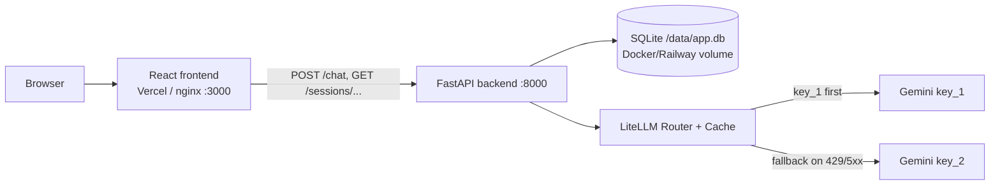

# Lyftr AI Assignment — Project Progress

> Living document. Last updated: after Phase 4 (frontend). Docker and deployment not started.
> Statuses: ⬜ not started · 🟨 implemented, not yet tested · ✅ implemented **and** tested.
> **“(fake LLM)” = verified by automated tests that run the real LiteLLM against a local fake LLM server. Nothing has yet been run against real Gemini — see Verification.**

## 1. Project Overview

Lyftr AI's assignment: build and ship a small chatbot end to end. A React page talks to a Python (FastAPI) backend, the backend calls an LLM through **LiteLLM**, and chat history is saved in **SQLite**. Four things are graded hard:

1. **Key failover** — if one API key hits a rate limit (HTTP 429), a quota error or a server error (5xx), the app silently retries with the next key.
2. **Response caching** — the same question (same model + same full message list) is answered from cache the second time, instantly, and labelled as such.
3. **Token and latency reporting** — every reply shows the input tokens, output tokens and milliseconds for that one request.
4. **Deployment** — frontend and backend are live on public URLs, and the whole thing also starts locally with `make up`.

The assignment is strict about the *contract*: exact URL paths, JSON field names, status codes and HTML `data-testid` values. A renamed field counts as a missing requirement.

## 2. Goal

A chat web app where you type a message, the bot replies with context from earlier turns, and under each reply you see: where the answer came from (`LIVE_INFERENCE` or `LLM_CACHE`), which model, latency in ms, input tokens, output tokens.

## 3. Requirements Checklist

(Source: `Lyftr_AI_Full_Stack_Assignment.pdf`, sections 2–8. Everything is mandatory except the system-prompt **UI** field.)

| # | Requirement | Status | Implementation | Verification |
|---|---|---|---|---|
| **API** | | | | |
| A1 | `GET /health` → 200 `{"status":"ok","keys_configured":N,"cache_enabled":true}` | ✅ | `main.py::health` — pings SQLite, checks key pool; 503 if DB/keys missing | `test_health`, `test_health_without_keys_is_unhealthy`; manual curl against real uvicorn → 200 (fake LLM) |
| A2 | `POST /chat` request: `session_id` (1–128), `message` (1–4000 after trim), optional `system_prompt` | ✅ | `schemas.py::ChatRequest` (Pydantic; message trimmed then 1–4000 chars) | `test_validation_errors_are_422_and_not_stored` (9 cases), `test_boundary_lengths_are_accepted` (fake LLM) |
| A3 | `POST /chat` 200 response: `session_id`, `reply`, `metadata{resolution_source, model, latency_ms, input_tokens, output_tokens, key_id, fallback_attempts}` | ✅ | `schemas.py::ChatResponse/ChatMetadata`; built in `main.py::chat` | `test_normal_chat_contract` (fake LLM) |
| A4 | `GET /sessions/{id}/messages` oldest-first, no system prompt, metadata on assistant msgs | ✅ | `main.py::session_messages` + `db.get_messages` | `test_history_endpoint` (fake LLM) |
| A5 | 422 for bad input (missing/empty/over-long, malformed JSON), JSON `detail` | ✅ | FastAPI default 422 `{"detail": ...}` | `test_validation_errors_are_422...`, `test_malformed_json_is_422` (fake LLM) |
| A6 | 503 `{"detail":"all providers unavailable"}` when every key fails | ✅ | `llm.AllProvidersUnavailable` → `main.py` returns 503 JSON | `test_all_keys_failing_returns_503` (5 header combos), `test_real_provider_failure_on_every_key_is_503` (fake LLM) |
| A7 | 404 `{"detail":"session not found"}` for unknown session on GET | ✅ | `main.py::session_messages` | `test_history_unknown_session_404` (fake LLM) |
| A8 | Failed requests (422/503) are never stored in history | ✅ | DB write happens only after the LLM succeeded, in one transaction (`db.save_exchange`) | `test_failed_request_is_not_added_to_history`, `test_failed_first_request_does_not_create_a_session` (fake LLM) |
| A9 | No stack traces / HTML error pages; exactly three endpoints | ✅ | Catch-all handler returns `{"detail":"internal server error"}`; `/docs`, `/redoc`, `/openapi.json` disabled | `test_unexpected_error_returns_json_without_stack_trace`, `test_unknown_route_is_json_not_html`, `test_only_the_three_endpoints_exist`, `test_503_never_leaks_keys_or_internals` (fake LLM) |
| **Behaviour** | | | | |
| B1 | Multi-turn: history per `session_id` in SQLite, client sends only the new message | ✅ | History loaded from SQLite per `session_id` and prepended to the new message | `test_multi_turn_sends_history_to_llm`, `test_sessions_are_separate`, `test_history_survives_app_restart` (fake LLM) |
| B2 | Cache key = model + full message list (system + history + new msg) | ✅ | LiteLLM cache key = model group + full message list (system + history + new) | `test_cache_key_includes_system_prompt`, `test_cache_key_includes_history`, `test_different_message_is_never_served_from_cache` (fake LLM) |
| B3 | Cache hit: identical `reply`, stored tokens, `key_id=null`, `fallback_attempts=0`, faster than live | ✅ | `llm.LLMService.complete` reads `cache_hit` from LiteLLM and sets `key_id=None`, `fallback_attempts=0` | `test_cache_hit_returns_identical_reply_and_stored_usage`, `test_cache_hit_is_faster_than_live_call`, `test_cache_miss_then_hit_in_new_session` (provider called once) (fake LLM) |
| B4 | Tokens are per request, never cumulative | ✅ | Tokens read from this request's LiteLLM `usage` | `test_tokens_are_per_request_not_cumulative`, `test_equal_length_first_messages_have_same_input_tokens` (fake LLM) |
| B5 | `latency_ms` integer, server-measured | ✅ | `time.perf_counter()` around history load + LLM call, cast to `int` | `test_normal_chat_contract` (int > 0), cache-faster test (fake LLM) |
| **LiteLLM / failover** | | | | |
| F1 | LiteLLM with ≥2 keys (`key_1`, `key_2`, in `LLM_API_KEYS` order) | ✅ | `llm.build_router`: deployments with `model_info.id = key_N`, order from `LLM_API_KEYS` | `test_three_keys_fall_through_in_order`, health `keys_configured` (fake LLM) |
| F2 | Auto-fallback on 429 / quota / 5xx | ✅ | Router `fallbacks=[{chat-key_1: [chat-key_2, ...]}]`, `num_retries=0`, cooldowns off | `test_real_provider_429_fails_over`, `test_real_provider_500_fails_over` (fake server returns real 429/500 HTTP responses) (fake LLM) |
| F3 | LiteLLM's built-in cache (in-memory or disk) | ✅ | `Router(cache_responses=True, cache_kwargs={"type":"local"})` + `caching=True` per call | cache tests above (fake LLM) |
| F4 | `X-Simulate-Failure` (`key_1=429`, `key_1=429,key_2=500`, `*=429`; 429/500/502/503), per-request only, only if `ENABLE_FAILURE_SIMULATION=true` | ✅ | `llm.FailureSimulationHook` (LiteLLM deployment hook) + `parse_simulation_header`; ContextVar scopes it to one request | `test_key_1_failure_fails_over_to_key_2` (5 header forms), `test_simulation_affects_only_that_one_request`, `test_simulation_header_ignored_when_switch_is_off`, `test_unknown_key_and_garbage_headers_are_ignored` (fake LLM) |
| F5 | `key_1=429` → 200 key_2 (attempts=1); `key_1=500` → 200 key_2; `*=429` → 503 | ✅ | see F4 | `test_key_1_failure_fails_over_to_key_2`, `test_all_keys_failing_returns_503` (`*=429`) (fake LLM) |
| **Storage** | | | | |
| S1 | SQLite only, file at `/data/app.db` via `DATABASE_URL`, schema auto-created | ✅ | `db.Database` (stdlib sqlite3); schema via `init_schema()` in app lifespan; path parsed from `DATABASE_URL` | `test_history_survives_app_restart`; manual: real uvicorn created `data/app.db` (fake LLM) |
| S2 | `messages(id, session_id, role, content, metadata, created_at)` | ✅ | `db.SCHEMA` — exact PDF columns + `sessions` table + index | `test_history_endpoint` (fake LLM) |
| **Frontend** | | | | |
| U1 | Chat UI, multi-turn, loading state, readable in-chat errors (422/503) | ✅ | `App.jsx` + `api.js`: message list, typing indicator, errors rendered as red bubbles inside the chat | `App.test.jsx` (15 tests); headless Chrome vs real backend: multi-turn, 503 and offline errors shown in chat (fake LLM) |
| U2 | Test IDs: `chat-input` (cleared after send), `send-button`, `assistant-message`, `meta-source`, `meta-model`, `meta-latency` (e.g. "812 ms"), `meta-input-tokens`, `meta-output-tokens` | ✅ | All 8 ids in `App.jsx`; metadata values are bare (e.g. `812 ms`, `42`), labels sit outside the test-id elements | `renders every assistant reply with all five metadata elements and the exact contents`, `shows LLM_CACHE exactly on a cache hit`; also read from the real DOM in Chrome (fake LLM) |
| U3 | `system-prompt-input` (optional field — we are building it) | ✅ | Always-visible textarea; value sent as `system_prompt` only when non-empty | `includes the system prompt only when one is typed` (fake LLM) |
| U4 | New session on every page load | ✅ | `useState(() => "s-" + crypto.randomUUID())` — evaluated once per page load | `uses the same session id within a page and a new one on each page load`; in Chrome the 2nd page load produced a `LLM_CACHE` hit for the same first message (fake LLM) |
| **Docker** | | | | |
| D1 | Multi-stage backend + frontend Dockerfiles, small runtime images | ✅ | both Dockerfiles | built, images 439 MB / 76 MB |
| D2 | `docker-compose.yml` at root, named volume at `/data` | ✅ | `docker-compose.yml` | restart keeps history |
| D3 | `Makefile` with `up`, `down`; stack on :8000 / :3000 | ✅ | `Makefile` | `make up` → :8000 / :3000 OK |
| D4 | All config via env vars: `LLM_API_KEYS`, `DATABASE_URL`, `ALLOWED_ORIGINS`, `ENABLE_FAILURE_SIMULATION` | ✅ | compose `environment:` | health, chat, failover OK in Docker |
| **Deployment & submission** | | | | |
| P1 | Public frontend URL (Vercel) | ⬜ | — | — |
| P2 | Public backend URL (Railway) with persistent volume, `ENABLE_FAILURE_SIMULATION=true` | ⬜ | — | — |
| P3 | CORS allows the frontend origin; UI works against live backend | ⬜ | — | — |
| P4 | Public GitHub repo: `/backend /frontend docker-compose.yml Makefile .env.example README.md` + backend tests | ⬜ | — | — |
| P5 | README with the 6 required sections | ⬜ | — | — |
| P6 | 2–3 min demo video with voice | ⬜ | (manual) | — |
| P7 | Submission form (within 24 h) | ⬜ | (manual) | — |

## 4. Decisions I Confirmed

| Decision | Your answer |
|---|---|
| LLM provider / keys | Gemini, 2 keys (two separate Google AI Studio keys) |
| Model | `gemini/gemini-3.5-flash-lite`, verified on real keys on 2026-11-24 (LIVE_INFERENCE via key_1). Env var `LLM_MODEL`. The PDF example `gemini-2.0-flash` was shut down on 1 Jun 2026. |
| Frontend hosting | Vercel |
| Backend hosting | Railway (you chose "Railway or Fly.io"; Railway picked for simpler GitHub deploys + volumes). Plan: start on Free/Trial, upgrade to Hobby ($5/mo) if the credit runs out. Render rejected: free web services can't attach a persistent disk. |
| UI polish | Clean & professional (Vite + React, plain CSS) |
| Time left | 8–18 hours → lean path, mandatory first |
| GitHub | Account exists, repo not yet created (you create the public repo and push) |
| Git commits | Logical commits |
| Bonus | None until everything mandatory is verified. System-prompt field is in scope because it is in the API contract anyway. |

## 5. Architecture (planned)



**Request flow for `POST /chat`:**
1. Validate body (Pydantic → 422 on failure).
2. Load session's system prompt (or default) and stored history from SQLite.
3. Build the message list `[system, ...history, new user message]`.
4. Parse `X-Simulate-Failure` (only if `ENABLE_FAILURE_SIMULATION=true`).
5. Start timer → call LiteLLM Router (cache → key_1 → fallback key_2) → stop timer.
6. If every key failed → 503, **nothing written** to SQLite.
7. Otherwise write user msg + assistant msg (with metadata JSON) in one transaction and return the response.

**Key design choices (to be verified against the installed LiteLLM version, then recorded here):**
- One Router model group *per key* (`chat-key_1`, `chat-key_2`), with group-level fallbacks. (Changed from the original plan after the spike — see section 10.)
- LiteLLM's built-in cache (in-memory by default; disk on the volume is a one-line switch). Backend runs a single worker so the in-memory cache is shared.
- Simulated failures are injected *inside* the LiteLLM call path so real fallback logic is exercised, never faked after the fact. Requests carrying `X-Simulate-Failure` skip the cache lookup so failover demos are deterministic (the PDF doesn't define cache-vs-simulation order; this is my assumption).
- Tokens come from the LiteLLM response `usage`; on a cache hit we return the usage stored with the cached response.
- `/docs`, `/redoc`, `/openapi.json` disabled — the PDF says the backend exposes *exactly* three endpoints.

## 6. Backend

**Structure** (`backend/app/`):

| File | Job |
|---|---|
| `config.py` | Reads env vars into a `Settings` object (`LLM_API_KEYS`, `LLM_MODEL`, `DATABASE_URL`, `ALLOWED_ORIGINS`, `ENABLE_FAILURE_SIMULATION`, plus optional `LLM_TIMEOUT_SECONDS`, `DEFAULT_SYSTEM_PROMPT`, `LLM_API_BASE`). |
| `schemas.py` | Pydantic request/response models. Field names are the PDF contract. |
| `db.py` | SQLite access (stdlib `sqlite3`, one short connection per operation). |
| `llm.py` | Everything LiteLLM: Router, key pool, fallback, cache, failure-simulation hook. |
| `main.py` | `create_app(settings)` — CORS, the three routes, JSON error handlers. `create_app_from_env` is the production entry point (`uvicorn app.main:create_app_from_env --factory`). |

**`POST /chat` step by step** (`main.py::chat`):
1. Pydantic validates the body → 422 if invalid.
2. Load the session's stored system prompt (or the default) and its history from SQLite.
3. Build `[system, ...history, new user message]` — this exact list is what LiteLLM sees, so it is also what the cache key is made from.
4. If `ENABLE_FAILURE_SIMULATION=true`, parse the `X-Simulate-Failure` header.
5. `LLMService.complete()` → LiteLLM (cache, then key_1, then key_2…).
6. Total failure → 503 `{"detail":"all providers unavailable"}` and **nothing is written**.
7. Success → compute `latency_ms`, write user + assistant rows in one transaction, return the contract JSON.

**Design details worth understanding**
- *Why `create_app(settings)` is a factory:* tests build many apps with different settings (2 keys, 3 keys, simulation off…). No global app object, no import-time side effects.
- *Latency:* measured with `time.perf_counter()` from the start of the handler to just before the DB write, so it includes the history lookup and the LLM/cache call.
- *Errors:* any LiteLLM exception after all keys are tried is turned into `AllProvidersUnavailable` → 503. The real error is logged on the server only. A catch-all handler turns bugs into `{"detail":"internal server error"}` (no stack trace). `/docs`, `/redoc`, `/openapi.json` are disabled because the PDF says the backend exposes *exactly* three endpoints.
- *Empty provider reply* is treated as a provider failure, because the contract says `reply` is non-empty.
- *`system_prompt`:* if sent, it overrides the default for the session and is remembered (stored in `sessions`); later requests without it reuse it. It is never returned by the history endpoint.
- *LiteLLM version:* pinned to **1.77.7**. Version 1.110.3 (latest on PyPI today) imports the LiteLLM *proxy* stack (needs `orjson`, `soundfile`, …) the moment the cache is used. 1.77.7 has the cache, router, fallbacks and the deployment hook we need without that baggage. See Problems.

## 7. Frontend

Vite + React 19, plain CSS, no UI/state libraries. Files in `frontend/src/`:

| File | Job |
|---|---|
| `main.jsx` | Mounts `<App/>`. |
| `api.js` | `sendChat()` — the only place that calls the backend. Reads the base URL from `VITE_API_URL` (build-time), turns every failure into a `ChatError` with a human-readable message. |
| `App.jsx` | The whole UI: `App` (state + sending), `Message` (user / assistant / error bubble), `Metadata` (the five required values). |
| `styles.css` | Styling. |
| `App.test.jsx` | 15 component tests (Vitest + Testing Library, `fetch` mocked). |

- **State:** just `useState` in `App`: `sessionId`, `messages[]` (`user`, `assistant` with `metadata`, or `error`), `input`, `systemPrompt`, `loading`. History lives on the *server*; the browser only displays it and sends the new message.
- **New session per page load:** `useState(() => "s-" + crypto.randomUUID())` runs once per page load, so a refresh = new session.
- **API communication:** `POST {VITE_API_URL}/chat` with `{session_id, message}` (+ `system_prompt` only when typed). The browser never sends `X-Simulate-Failure` — that header is for curl/Postman in the demo.
- **Message rendering:** user bubble (right), assistant bubble (left) containing the reply and the metadata row. `white-space: pre-wrap` keeps line breaks.
- **Metadata rendering:** every assistant bubble is `data-testid="assistant-message"` and contains `meta-source` (badge: teal = `LIVE_INFERENCE`, amber = `LLM_CACHE`), `meta-model`, `meta-latency` (`812 ms`), `meta-input-tokens`, `meta-output-tokens`. The test-id elements contain *only* the value (so a grader reading `meta-input-tokens` gets `42`, not `input tokens 42`); the labels are separate spans. Extra (not required): `key_N · N fallbacks`, which makes failover visible in the demo.
- **Loading state:** animated typing bubble (`loading-indicator`); Send is disabled while waiting and when the box is empty. Enter sends, Shift+Enter inserts a newline. The input is cleared immediately on send.
- **Error states** (all shown as a red bubble *inside the chat*, never a blank screen): 422 → "That message couldn't be sent: <reason>…"; 503 → "All AI providers are unavailable right now…"; network failure → "Can't reach the server…"; anything else (including a non-JSON body) → "Something went wrong on the server (status N)…". Error bubbles deliberately do **not** carry `data-testid="assistant-message"`, so that id only ever marks real replies.
- **Failed messages:** the backend does not store a failed request, so the next message won't include it as context. The user's bubble stays visible followed by the error, so it is clear what happened.

## 8. Database

SQLite, a single file (`DATABASE_URL`, e.g. `sqlite:////data/app.db`). Chosen because the assignment requires it ("SQLite only") and it needs no extra service.

```sql
messages (id INTEGER PK AUTOINCREMENT, session_id TEXT, role TEXT, content TEXT, metadata TEXT, created_at TEXT)  -- exactly the PDF's table
CREATE INDEX idx_messages_session ON messages (session_id, id);                                                   -- fast history lookup
sessions (session_id TEXT PK, system_prompt TEXT, created_at TEXT)                                                -- one row per session
```
- **Sessions:** the client invents a `session_id` (the frontend generates a new one on every page load). A session "exists" once its first successful exchange is stored. A *failed* first request therefore leaves no session and `GET /sessions/<id>/messages` stays 404.
- **Messages:** one `user` row + one `assistant` row per successful turn, written in a single transaction so history can never contain half a turn.
- **Metadata:** the assistant row's `metadata` column holds the full metadata JSON (`resolution_source, model, latency_ms, input_tokens, output_tokens, key_id, fallback_attempts`). User rows have `NULL`.
- **Schema creation:** `CREATE TABLE IF NOT EXISTS` runs on every start-up (FastAPI lifespan). WAL journal mode is on.
- **Persistence:** the file lives on a Docker named volume (`/data`) locally, and on a Railway volume in production, so history survives restarts. *(Docker/Railway parts not yet built — see sections 13–14.)*

## 9. Caching

- **What is cached:** the complete LiteLLM response, including the `usage` (token counts) that came with it.
- **Cache key:** LiteLLM hashes the model group + the full message list (system prompt + history + new message). So the same first message in a *new* session is a hit (same system prompt, no history), but the same text later in a conversation is a miss (different history), and a different system prompt is a miss.
- **Hit:** returns the identical reply and the stored token counts; we report `resolution_source = LLM_CACHE`, `key_id = null`, `fallback_attempts = 0`, and the latency is a few ms instead of a full provider round trip.
- **Miss:** goes to key_1 (then key_2 if needed), reports `LIVE_INFERENCE`, and the answer is stored.
- **Type:** LiteLLM in-memory cache (allowed by the PDF). It is lost when the backend restarts; chat *history* is not (that is SQLite). Single uvicorn worker so all requests share one cache.
- **Why the assignment wants it:** repeated questions cost no API quota and return instantly.
- **How to demo a hit:** send the same first message twice from two different sessions (reload the page between). See the API examples below.
- **Test-only wrinkle:** with this LiteLLM version the router only *reads* the cache when `caching=True` is passed on the call, so `LLMService.complete` passes it on every request.
- **Simulated-failure requests skip the cache read** (`cache={"no-cache": True}`) so the 503 / failover demos are deterministic even if the same prompt was cached before. *This is my assumption — the PDF doesn't say.*

## 10. Key Failover

```
Normal:    key_1 → success                         → 200, key_id=key_1, fallback_attempts=0
Failure:   key_1 → 429/5xx → key_2 → success       → 200, key_id=key_2, fallback_attempts=1
All fail:  key_1 → fail, key_2 → fail              → 503 {"detail":"all providers unavailable"}
```
**How it is built:** `build_router` creates one LiteLLM model group per key (`chat-key_1`, `chat-key_2`, …, with `model_info.id = key_1/key_2`). We always call `chat-key_1`; the Router has `fallbacks=[{"chat-key_1": ["chat-key_2", …]}]`, so any failure moves the same request to the next key. `num_retries=0` (no blind retry on the same key) and `disable_cooldowns=True` (a failed key is *not* blacklisted — so the next request starts at key_1 again, and simulated failures never "stick").

**Why group-per-key instead of one group with two deployments:** I first tried one group with two deployments and priority `order` (with retries on); the failure was retried on the same priority-1 deployment and never reached key_2. The usual fix, enabling cooldowns, would blacklist key_1 for later requests, which breaks the "that one request only" rule, so I did not use it. Explicit group fallbacks behave exactly as the assignment describes. (Spike notes in Problems.)

**`X-Simulate-Failure`** (only honoured when `ENABLE_FAILURE_SIMULATION=true`):
- Header format: `key_1=429`, `key_1=429,key_2=500`, `*=429` (statuses 429/500/502/503). Unknown keys, unsupported statuses and garbage are ignored.
- Implementation: `FailureSimulationHook` is a LiteLLM *deployment hook* — it runs after LiteLLM chose a deployment and just before it would call the provider. If that deployment's key id is listed it makes LiteLLM raise the matching exception (`RateLimitError`, `InternalServerError`, …). The Router sees a normal provider failure, so the **real** fallback code runs. The failure map lives in a `ContextVar`, which is private to each request, so concurrent requests cannot affect each other.
- The simulated request still returns a real answer from the next key (never an error wrapped in a 200).

## 11. API Contract

**GET /health** → `200 {"status":"ok","keys_configured":2,"cache_enabled":true}`

**POST /chat**
```json
// request
{ "session_id": "s-7f3a", "message": "What is the capital of France?", "system_prompt": "optional" }
// 200 response
{ "session_id": "s-7f3a", "reply": "…",
  "metadata": { "resolution_source": "LIVE_INFERENCE", "model": "gemini/gemini-3.5-flash-lite",
                "latency_ms": 812, "input_tokens": 42, "output_tokens": 9, "key_id": "key_1", "fallback_attempts": 0 } }
// 422 {"detail": [...]}      503 {"detail": "all providers unavailable"}
```
**GET /sessions/{session_id}/messages** → `{"session_id":…, "messages":[{"role":"user","content":…},{"role":"assistant","content":…,"metadata":{…}}]}`; unknown id → `404 {"detail":"session not found"}`.

(Real Gemini response bodies will be pasted here once you run it with your keys.)

## 12. Testing

Command: `cd backend && pip install -r requirements-dev.txt && pytest`

**Approach:** the tests do **not** mock LiteLLM. `conftest.py` starts a tiny fake OpenAI-compatible LLM server on localhost (it sleeps 250 ms per call, counts one token per word, and answers a real HTTP 429/500 when the API key starts with `fail-429` / `fail-500`) and points the real LiteLLM at it through `LLM_API_BASE`. Router, cache, fallback and hook are therefore the real code. Each test gets a fresh SQLite file, a fresh app, and an empty cache.

| What | How | Expected | Actual |
|---|---|---|---|
| health | `GET /health` | 200 `{status ok, keys 2, cache true}` | ✅ pass |
| normal chat | `POST /chat` | all contract fields, `LIVE_INFERENCE`, key_1, attempts 0 | ✅ pass |
| multi-turn | 2 messages same session | 2nd prompt has 4 messages (system, user, assistant, user) | ✅ pass |
| separate sessions | session B after A | B's prompt has only 2 messages | ✅ pass |
| cache miss → hit | same first message, two sessions | `LIVE_INFERENCE` then `LLM_CACHE`; fake provider called once | ✅ pass |
| identical cached reply | compare | same reply, tokens, model; key_id null; attempts 0 | ✅ pass |
| cache faster | compare latency | hit < live (live ≥ 250 ms) | ✅ pass |
| different message | other text | never cached | ✅ pass |
| cache key parts | other system prompt / extra history | miss | ✅ pass |
| token usage | turn 2 vs turn 1; equal-length first messages | per-request, not cumulative; equal across sessions | ✅ pass |
| key_1 fail → key_2 | `key_1=429/500/502/503` header | 200, key_2, attempts 1, provider saw only key_2 | ✅ pass |
| real upstream 429 / 500 | fake server answers 429/500 | fail over to key_2 | ✅ pass |
| 3 keys | first two fail | key_3, attempts 2 | ✅ pass |
| all keys fail | `key_1=429,key_2=500`, `*=429`, … + real upstream failures | 503 exact body | ✅ pass |
| failed request not stored | 503 on existing and brand-new session | history unchanged / session still 404 | ✅ pass |
| simulation off | switch false + header | header ignored, normal 200 | ✅ pass |
| simulation is per-request | failover request then normal | normal one uses key_1 again | ✅ pass |
| validation | 9 bad payloads + boundaries + malformed JSON | 422 / 200 at 4000 chars | ✅ pass |
| unknown session | `GET /sessions/x/messages` | 404 `{"detail":"session not found"}` | ✅ pass |
| persistence | new app on same DB file | history still there | ✅ pass |
| no leaks | 503 body, 500 body | no keys, no traceback | ✅ pass |
| CORS | preflight from allowed / other origin | allowed + `x-simulate-failure` header ok / no header | ✅ pass |
| JSON-only, 3 endpoints | `/nope`, `/docs`, `/openapi.json` | 404 JSON | ✅ pass |

**Result:** `58 passed` (3 consecutive runs, no flakiness). **Mutation check:** switching caching off → 3 tests fail; removing fallbacks → 10 tests fail, so the tests do detect those bugs.
**Manual smoke test:** started the real server with `uvicorn --factory` and curled it: `/health` → 200; `POST /chat` with `*=429` → 503 JSON and no session stored; DB file created automatically.

**Not covered by these tests (needs you):** a real Gemini call, a real Gemini 429, and the cache against real Gemini.

**Frontend tests:** `cd frontend && npm install && npm test` → `15 passed` (mutation check: renaming `send-button` makes 13 fail). `npm run build` succeeds (≈225 kB JS, 71 kB gzipped).

**Browser check (headless Chrome ↔ real backend ↔ fake LLM, both on localhost, ports 3000/8000, so real CORS was exercised):** typed a message → `LIVE_INFERENCE`, input cleared; second message → backend saw the whole history; new page load + same first message → `LLM_CACHE`, 3 ms vs ~650 ms live, identical reply and tokens; backend whose keys all return 429 → readable 503 bubble, zero assistant messages; browser set offline → readable "Can't reach the server". No console errors except a favicon 404, which I then fixed.

## 13. Docker — built and verified (2026-11-24)
- `backend/Dockerfile`: multi-stage (builder installs deps into a venv; runtime copies venv + app), listens on `$PORT` (default 8000), `DATABASE_URL=sqlite:////data/app.db`. Image ≈ 439 MB.
- `frontend/Dockerfile`: multi-stage (node builds the Vite bundle with build arg `VITE_API_URL`; nginx serves it on :3000, SPA fallback in `nginx.conf`). Image ≈ 76 MB.
- `docker-compose.yml`: backend :8000 + frontend :3000, named volume `chat-data` mounted at `/data`; reads `.env` (requires `LLM_API_KEYS`).
- `Makefile`: `make up` (`docker compose up --build -d`), `make down`.

**What actually happened (Docker Desktop, run on the user's Mac):**
- `make up` built both images and started both containers on the **first attempt** — no Dockerfile, compose or runtime fixes were needed.
- `GET http://localhost:8000/health` → 200 `{"status":"ok","keys_configured":2,"cache_enabled":true}`.
- `GET http://localhost:3000` → 200, serves the app (`<title>Lyftr Chat</title>`). CORS preflight from `http://localhost:3000` is allowed.
- Real Gemini through the containers: first `POST /chat` → `LIVE_INFERENCE`, `key_1`, 1487 ms, 28 in / 4 out tokens. Same first message in a new session → `LLM_CACHE`, 3 ms, identical reply and tokens, `key_id=null`.
- Failover in Docker: `X-Simulate-Failure: key_1=429` → 200 via `key_2`, `fallback_attempts=1`.
- **Persistence:** after `docker compose restart backend`, `/health` was OK again and `GET /sessions/<id>/messages` returned the full earlier exchange with its metadata (the SQLite file lives on the `chat-data` volume). A follow-up message in that session ("What did I just ask you?") was answered correctly, so stored history is also fed back to the model.
- **Expected side effect:** the LiteLLM cache is in-memory, so it is emptied by a restart: the same prompt that was `LLM_CACHE` before the restart was `LIVE_INFERENCE` after it. Chat history is not affected.
- `.env` is listed in `.gitignore` and is not inside the backend image (`/app/.env` absent); it was never read or printed during this check.
- **Not tested:** clicking through the UI in a browser at :3000 (only the served page and the API were checked with curl). The stack is still running; stop it with `make down` (the volume is kept).

## 14. Deployment
- **Decision (2026-11-25):** backend on Render **free** plan + Vercel frontend, with a free uptime monitor pinging `/health` every 5–14 min to avoid cold starts. Config: `render.yaml`, `frontend/vercel.json`.
- **Known limitation:** Render free has no persistent disk, so SQLite history and the in-memory cache are lost on every restart or redeploy (not on idle spin-down alone, which the monitor prevents). Durable history needs `plan: starter` + a disk. Do not redeploy right before grading/demo.
- Status: config written and pushed; not yet deployed (user does the Render/Vercel clicks).

## 15. Problems Encountered

**Problem: the PDF's example model is dead.**
- *What happened?* `gemini/gemini-2.0-flash` appears in the PDF's sample response.
- *Cause?* Google's deprecations page lists `gemini-2.0-flash` with a shutdown date of 1 Jun 2026.
- *Solution:* model name comes from env var `LLM_MODEL`; default `gemini/gemini-3.5-flash-lite`. Real-key findings: `gemini-2.5-flash` returned 404 ("no longer available to new users"); `gemini-3.8-flash` returned 503 "high demand" on both keys; `gemini-3.5-flash-lite` worked.
- *Lesson:* never hard-code a model id; examples in an assignment can be stale.

**Problem: LiteLLM 1.110.3 breaks the cache with missing modules.**
- *What happened?* First cache call failed with `ModuleNotFoundError: orjson`, then `soundfile`.
- *Cause?* In that version the cache code imports parts of the LiteLLM proxy server, which need extra packages.
- *Solution:* pin `litellm==1.77.7` (has everything we need, no proxy imports).
- *Lesson:* pin the library version you tested; "latest" can change which optional dependencies are required.

**Problem: failover did not happen with two deployments in one model group.**
- *What happened?* `key_1=429` raised an error instead of using key_2.
- *Cause?* LiteLLM's within-group retry kept choosing the same priority-1 deployment (observed in the spike); cooldowns would blacklist key_1 for later requests.
- *Solution:* one model group per key + `fallbacks`, `num_retries=0`, `disable_cooldowns=True`.
- *Lesson:* test the failure path with a spike before building on a library's default behaviour.

**Problem: LiteLLM's mock mode skips the cache, so mocked tests can't prove caching.**
- *Solution:* tests run against a local fake LLM HTTP server (real request/response path, real 429/500).

**Problem: cache hit never happened in tests.**
- *Cause:* the Router only reads the cache when `caching=True` is passed per call (this version).
- *Solution:* `LLMService.complete` always passes `caching=True`; covered by tests (turning it off fails 3 tests).

**Problem: tests leaked state into each other** (`LLM_CACHE` on a first request; "Queue bound to a different event loop"; "MAX_CALLBACKS limit of 30").
- *Cause:* LiteLLM keeps process-global state (cache, logging queue, callback list); each test builds a new app.
- *Solution:* an autouse fixture in `conftest.py` resets those globals. Production runs one app in one process, so it is unaffected.

**Problem: LiteLLM logs a long traceback for every failed-over attempt.**
- *Solution:* LiteLLM loggers set to CRITICAL in `create_app_from_env`; our own logger records one WARNING line when all providers fail.

## 16. Verification — _final checklist filled at the end_
## 17. Final Submission

- GitHub URL: _placeholder_
- Frontend URL: _placeholder_
- Backend URL: _placeholder_
- Demo video: _placeholder_
- Submission form submitted: ☐

---

## Appendix — Implementation plan

| Phase | What | Commit |
|---|---|---|
| 0–1 | Requirements, decisions, architecture (this file) | — |
| 2 | Backend: FastAPI, SQLite, LiteLLM Router, cache, tokens, latency, failure hook, CORS, env config | 1 "scaffold + backend core", 2 "failover + cache" |
| 3 | Backend tests (pytest, LiteLLM mock responses — see limits below) | 3 "backend tests" |
| 4 | React frontend with required test IDs | 4 "frontend" |
| 5 | Dockerfiles, compose, Makefile | 5 "docker" |
| 6 | Integration check (CORS, URLs, metadata, cache, failover) | — |
| 7 | Deploy: Vercel + Railway (config files prepared by me; you click) | — |
| 8–9 | FINAL_CHECKLIST.md, README.md, DEMO_SCRIPT.md | 6 "docs" |

**Known limits of my sandbox (so nothing is over-claimed):**
- It cannot reach the Gemini API (403 from the egress proxy), so automated tests use LiteLLM mock responses and simulated failures. Real-key behaviour (live cache hit, real 429 failover) must be confirmed by you running the app with your keys — those rows stay "not verified by Claude" until you do.
- Deployed-URL checks (Vercel/Railway/CORS in production) also need you.
- Docker CLI and daemon are present here, so I will try `make up`; I'll report if it can't run.

**LiteLLM risks resolved by the spike:** key id (`_hidden_params["model_id"]`), fallback count (`x-litellm-attempted-fallbacks` header), cache-hit flag (`_hidden_params["cache_hit"]`) and cached usage all behave as needed on 1.77.7.
